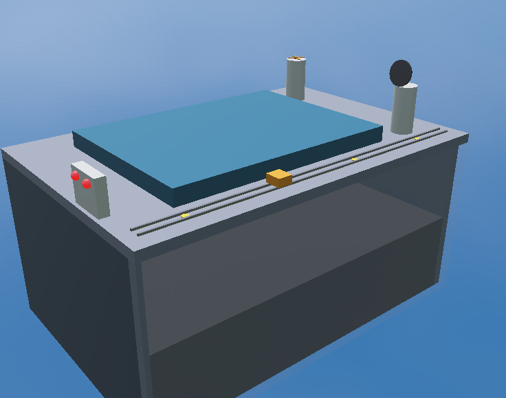

# TEKS4430 projektityö: lastiruuman kaasuvalvonta, tuuletus ja näytteenottovaunu

Autonominen kyberfyysinen järjestelmä bulk-aluksen ruumaan, jossa on kivihiiltä tai kalkkikiveä. Järjestelmä valvoo kaasuja (CO, CH₄, O₂) ja lastin lämpötilaa, ohjaa ruuman pintatuuletusta ja käyttää kannella kiskoilla kulkevaa vaunua, joka ottaa kaasunäytteet ruuman neljästä näytteenottoaukosta.

Ydinongelma on ristiriita: tuuletus poistaa räjähdysvaarallista metaania, mutta tuo happea, joka kiihdyttää kivihiilen itsekuumenemista, ja samalla laimentaa CO-lukemat, jotka ovat itsekuumenemisen paras indikaattori.



## Arkkitehtuuri

| Kerros | Solmu | Tehtävä |
|---|---|---|
| Prosessi | `plant_sim` | Vyöhykkeinen prosessimalli (4 vyöhykettä), poistoanturi ja vaunun sondianturi |
| Simulaatio | `hold_driver` (Webots-lisäosa) | Tuuletin, pelti, vaunu, sondi, merkkivalot; mitattu tila ja simulaatioaika |
| Sensing and perception | `perception` | Suodatus, CO:n tuottonopeuden arvio massataseesta vyöhykkeittäin, kuumenemiskohdan paikannus, anturivian tunnistus |
| Reasoning and decision-making | `hold_manager` | py_trees-käyttäytymispuu: tuuletustila, metaanin asetusarvo, hälytystaso, näytteenoton prioriteetti |
| Act and control | `vent_control` | PI-säätö metaanille tuulettimen nopeudella, pelti/tuuletin-lukitus, merkkivalot |
| Act and control | `rover_control` | Vaunun tilakone ja PID-asentosäätö, aikakatkaisut |
| Arviointi | `recorder` | CSV-loki ajosta (todellinen tila, maailmamalli, päätökset) |

Kaikkien solmujen logiikka on erillisissä ROS-riippumattomissa moduuleissa (`*_core.py`, `process_model.py`, `sensor_model.py`), joita ROS-solmut käärivät. Sama logiikka ajetaan yksikkötesteissä ja suljetun silmukan simulaatiossa ilman ROSia.

### Aiheet

| Aihe | Tyyppi | Julkaisija → tilaaja |
|---|---|---|
| `/hold/actuator_state` | ActuatorState | hold_driver → plant_sim, perception, vent_control, rover_control |
| `/hold/sensors` | HoldSensors | plant_sim → perception |
| `/hold/probe_reading` | ProbeReading | plant_sim → rover_control |
| `/hold/zone_sample` | ZoneSample | rover_control → perception |
| `/hold/state` | HoldState | perception → hold_manager, vent_control |
| `/hold/vent_command` | VentCommand | hold_manager → vent_control |
| `/hold/alert` | Alert | hold_manager → vent_control |
| `/hold/sampling_plan` | SamplingPlan | hold_manager → rover_control |
| `/hold/fan_cmd`, `/hold/damper_cmd` | Float64 | vent_control → hold_driver |
| `/hold/status_led`, `/hold/alert_led` | Int32 | vent_control → hold_driver |
| `/hold/rover_vel_cmd`, `/hold/probe_cmd` | Float64 | rover_control → hold_driver |
| `/hold/truth` | ZoneTruth | plant_sim → recorder (vain arviointiin) |

Aikapohja: driver lukee Webotsin simulaatioajan (`robot.getTime()`) ActuatorState-viestiin. Prosessiaika = simulaatioaika × `time_scale` (oletus 600, eli 1 s = 10 prosessiminuuttia). Järjestelmä pysyy synkronissa, vaikka Webots pyörisi reaaliaikaa hitaammin.

## Ajaminen

Ympäristö on sama kuin kurssin tehtävissä (Webots natiivisti, ROS 2 Jazzy Dev Containerissa). Kopioi `env.example` tiedostoksi `.env` ja valitse käyttöjärjestelmän rivit.

1. Avaa Webotsissa `src/worlds/cargo_hold.wbt` ja käynnistä simulaatio.
2. Kontissa:
   ```bash
   cd /ros2_ws && colcon build --symlink-install && source install/setup.bash
   ros2 launch hold_autonomy hold.launch.py scenario:=coal_both
   ```
   Skenaariot: `coal_methane`, `coal_selfheat`, `coal_both`, `limestone`. Anturivika: `co_drift:=1.0`. Kesto: `duration_h:=120.0` (≈ 12 min reaaliajassa).
3. Loki tallentuu kontissa kansioon `/ros2_ws/logs/` (koneellasi projektin `logs/`). Kuvaaja ja tunnusluvut kontissa: `python3 /ros2_ws/analysis/plot_run.py /ros2_ws/logs/<tiedosto>.csv`

Ilman Webotsia (kontissa):
```bash
cd /ros2_ws/src/hold_autonomy && python3 -m pytest test   # 29 yksikkötestiä
python3 /ros2_ws/analysis/run_closed_loop.py              # kaikki skenaariot + IMSBC-vertailu
```

## Tulokset

Suljetun silmukan simulaatio (`analysis/run_closed_loop.py`), 120 h, vertailukohtana IMSBC-käsimenettely (24 h tuuletus, miehistö mittaa aukoista kerran päivässä):

| Skenaario | Mittari | Käsimenettely | Autonominen |
|---|---|---|---|
| Metaani | CH₄ max / tunnit yli 20 % LEL | 86 % / 41,5 h | 14,4 % / 0 h |
| Itsekuumeneminen | tunnistus / kuumenemiskohdan max T | 32 h / 52 °C | 16,9 h (vyöhyke 1 oikein) / 38 °C |
| Molemmat | tunnistus ja miehistöhälytys / CH₄ yli 20 % / T ≥ 60 °C | 32 h / 28,2 h / 34,5 h | 10,0 h / 0 h / 35,1 h |
| Kalkkikivi | väärät hälytykset | – | ei yhtään |
| Poistoanturin ryömintä | anturivika tunnistettu | – | 35,7 h (pelkkä poistoanturi olisi antanut väärän hälytyksen 28,3 h) |

Samat skenaariot ajettiin myös Webotsissa kaikkien solmujen kanssa; tulokset vastaavat simulaatiota (kuvaajat `docs/results/webots_*.png`). Tarkemmin: `docs/suunnittelu.md`.

## Mallin rajoitukset

Prosessimalli on laadullinen eikä kalibroitu todelliseen lastidataan. Happi kuluu suljetussa ruumassa todellista nopeammin, CO:n osuus kasvaa lineaarisesti lämpötilan mukana, ja yli 150 °C:n lämpötilat leikataan (avotuli, malli ei ole pätevä). Ruuman ilmanvaihtokerroin ja vyöhykkeiden sekoittumiskerroin oletetaan tunnetuiksi; todellisuudessa ne pitäisi tunnistaa mittauksista.